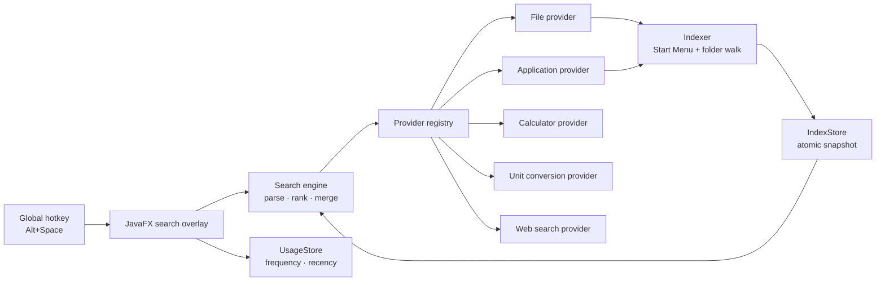

# Lumen

**Everything. One keystroke away.**

Lumen is a fast, native universal search and productivity launcher for Windows 11.

Press `Alt + Space`, type what you're looking for, and hit `Enter`.

Launch applications, find files and folders, calculate expressions, convert units, and search
the web — all from one lightweight, keyboard-driven interface.

Built with **Java 21, JavaFX and JNA**, Lumen runs as a native desktop application without an
embedded browser engine or a separate backend service.


## Why Lumen?

- **Instant access** — summon the overlay from anywhere with a global keyboard shortcut.
- **Unified search** — applications, files and folders in one ranked list.
- **Built-in tools** — calculate expressions and convert units without opening anything else.
- **Intelligent ranking** — frequently and recently used results float to the top.
- **Local-first** — the index and usage history never leave your computer.
- **Extensible architecture** — independent providers make new capabilities additive.

Lumen is inspired by macOS Spotlight, with a focus on native Windows integration, performance
and privacy.

**Your desktop. Everything within reach.**

## Quick start

Requires JDK 21 (the build uses `maven.compiler.release=21`) and Maven 3.9+.

Development:

```powershell
git clone <this-repo> lumen
cd lumen
mvn javafx:run
```

Daily use — build the app image, install it under `%LOCALAPPDATA%\Programs\Lumen`, add an
autostart shortcut, and launch it:

```powershell
scripts\build-installer.ps1
scripts\install.ps1
```

`scripts\install.ps1 -NoAutostart -NoLaunch` installs without touching startup or launching.
`scripts\run.ps1` runs from source.

Lumen starts in the tray and stays out of the way. Press **Alt+Space** from anywhere to summon
it; the overlay also opens once on a fresh install so you know it works.

> **Ctrl+Alt+Space** is always registered as a backup, so the launcher stays usable if another
> app owns Alt+Space. The active combination is shown in the tray tooltip and logged at startup.

## Keys

| Key | Action |
| --- | --- |
| `Alt+Space` | Show / hide the overlay |
| `Enter` | Open the selected result |
| `Ctrl+Enter` | Show the selected item in Explorer |
| `↑` `↓` / `Tab` | Move the selection |
| `Esc` | Clear the query, then close |

The overlay hides as soon as Windows gives the foreground to another window — clicking away,
`Alt+Tab`, or a UAC prompt all release it. It never sits on top of an application you are
trying to use. Set `"hideOnFocusLoss": false` in the config to keep it open until `Esc` or the
hotkey instead.

## Features

### Discovery

- **Applications** — every `.lnk`, `.url`, `.exe` and `.appref-ms` in the user and machine
  Start Menus.
- **Files and folders** — everything under the configured roots, skipping hidden items,
  `node_modules`, `.git`, `target`, `AppData`, and similar noise.
- **Ranking** — name matches outrank path matches; frequency and recency boost results you
  already use; ties break deterministically.

### Built-in tools

- **Calculations** — `12 * (3 + 4)`, `sqrt(144)`, `2^10`, `pi * 2`. `Enter` copies the result.
- **Unit conversions** — `10 km to miles`, `1 kg in lb`, `100 c to f`, `1 mb to kb`,
  `90 min to hours`.

### Integrations

- **Web search** — anything else offers "Search the web for …" as the last row.
- **Everything SDK** — full-disk search through Everything is **planned, not implemented yet**.
  Today file search covers the folders configured under `roots`.

## Query syntax

Filters and aliases can be mixed with normal words. Filters are parsed before scoring, so they
never compete with the text match.

| Query | What it does |
| --- | --- |
| `report ext:pdf` | files whose name matches `report` and end in `.pdf` |
| `report type:pdf` | same thing; `type:` is an alias for `ext:` |
| `kind:folder projects` | only folders |
| `kind:file,app budget` | only files and apps |
| `in:downloads setup` | only paths containing `downloads` |
| `invoice -draft` | exclude anything containing `draft` |
| `apps chrome` | app results only |
| `files report` | files and folders only |
| `folders projects` | folders only |
| `web cats` / `g cats` | go straight to a web search |
| `calc 2+2` / `= 2+2` | go straight to the calculator |

A leading alias routes the query to one source and is stripped before matching. Without an
alias every source runs and the best result wins.

## Configuration

Settings live in `%LOCALAPPDATA%\Lumen\config.json` (created on first run):

```json
{
  "hotkey": "ALT+SPACE",
  "roots": ["C:\\Users\\you\\Desktop", "C:\\Users\\you\\Documents"],
  "maxDepth": 8,
  "maxIndexedFiles": 120000,
  "maxResults": 40,
  "showOnStartup": false,
  "hideOnFocusLoss": true,
  "webSearchUrl": "https://www.google.com/search?q=%s"
}
```

Backslashes in Windows paths must be doubled in JSON, as above. Restart the app after editing.
Hotkey syntax is `MOD+MOD+KEY`, e.g. `CTRL+ALT+S`, `WIN+SPACE`, `ALT+F2`.

`index.json` (search snapshot) and `usage.json` (ranking history) sit next to the config.
Deleting `index.json` is safe — it is rebuilt on the next start.

Upgrading from the pre-rename build? Settings, usage and the index are copied from
`%LOCALAPPDATA%\SpotlightWin` once, on first run.

## Architecture



Search runs on the JavaFX thread on purpose: at these latencies, dispatching to a worker and
back would cost more than the search itself. The index array is swapped atomically, so a
rebuild never blocks a query or produces a torn view.

## Install as a real app

```powershell
scripts\build-installer.ps1
scripts\install.ps1
```

The first command produces a self-contained app image in `dist\Lumen\` with a bundled runtime
(~160 MB, no Java required on the target machine). The second copies it to
`%LOCALAPPDATA%\Programs\Lumen` and, unless `-NoAutostart` is passed, adds a `Lumen.lnk`
shortcut to the Startup folder so it launches at login. It then starts the app.

Uninstall:

1. Right-click the tray icon and choose **Quit**.
2. Delete `%LOCALAPPDATA%\Programs\Lumen`.
3. Delete `Lumen.lnk` from `shell:startup`.
4. Optionally delete `%LOCALAPPDATA%\Lumen` to remove settings, index and history.

For an `.exe`/`.msi` installer instead of an app image, install
[WiX Toolset](https://wixtoolset.org/) and run `jpackage --type msi ...` with the same
arguments (see the script). A signed MSI and auto-update are on the roadmap.

## Performance

Measured on the development machine (Windows 11, warm file cache) with the built-in benchmark.
Treat these as orders of magnitude for this design, not universal guarantees:

| Step | Time |
| --- | --- |
| Load index snapshot at startup (3.4k items) | 62–118 ms |
| Full reindex (warm cache, background) | 0.6–1.7 s |
| Keystroke → ranked results (3.4k items) | 0.48 ms p50 / 1.47 ms p95 |
| Keystroke → ranked results (120k items, typical query) | 2–7 ms p50 |
| Keystroke → ranked results (120k items, filter or broad match) | 7–11 ms p50, up to 18 ms p95 |
| Hotkey → window visible (warm) | 45–88 ms |

Run the benchmark yourself:

```powershell
mvn -q -Dtest=SearchBenchmarkTest -Dbench=true test
```

## Project layout

```
src/main/java/dev/lumen/
  LumenApp.java            wiring: config, index, providers, tray, hotkey
  ui/Overlay.java          the borderless search window
  ui/ResultCell.java       one result row
  core/Indexer.java        Start Menu + folder walker (virtual thread)
  core/IndexStore.java     in-memory index + JSON snapshot
  core/SearchEngine.java   query parse, alias routing, provider merge
  core/SearchQuery.java    tokens, ext:/kind:/in:/- filters, aliases
  core/SearchText.java     normalization, acronym, compact matching
  core/FuzzyMatcher.java   tiered scoring
  core/UsageStore.java     frequency/recency boost
  providers/               one class per result source
  platform/                Win32: hotkey, ShellExecute, tray
  calc/                    expression parser + unit tables
```

## Verifying a change

```powershell
scripts\verify.ps1            # tests + source-size guard
scripts\verify.ps1 -Package   # also builds the app image
scripts\verify.ps1 -Bench     # run the opt-in latency benchmark
```

The script fails loudly and prints `VERIFY PASSED` only when everything is green.

See [docs/ARCHITECTURE.md](docs/ARCHITECTURE.md) for the design rationale,
[docs/ROADMAP.md](docs/ROADMAP.md) for the improvement plan, and
[docs/REFERENCE-PATTERNS.md](docs/REFERENCE-PATTERNS.md) for which patterns were borrowed from
[quick-search](https://github.com/teja2495/quick-search) and why.

## Roadmap

Shipped:

- [x] App launch + file search
- [x] Global hotkey overlay with a permanent backup combination
- [x] Hotkey supervision: re-registration after loss, sleep/resume and RDP sessions
- [x] Native foreground tracking so the overlay never blocks Alt+Tab or clicks
- [x] Calculator + unit conversion
- [x] Web search fallback
- [x] Provider-based extensibility
- [x] Single instance, tray fallback, file logging

Planned, in priority order — see [docs/ROADMAP.md](docs/ROADMAP.md) for targets, acceptance
criteria and effort estimates:

- [ ] Ranking evaluation dataset instead of tuning by intuition (P1)
- [ ] Full-disk search via the Everything SDK, then Windows Search (P1)
- [ ] jlink runtime + AppCDS: smaller install, faster cold start (P1)
- [ ] Real shell icons, UWP/Store apps, running-window switching (P1)
- [ ] Settings UI with live hotkey capture (P1)
- [ ] Complete the Lumen visual identity in JavaFX (P1)
- [ ] Clipboard history, content search, system commands (P2)
- [ ] Signed MSI, auto-update, CI (P2)

## License

MIT
